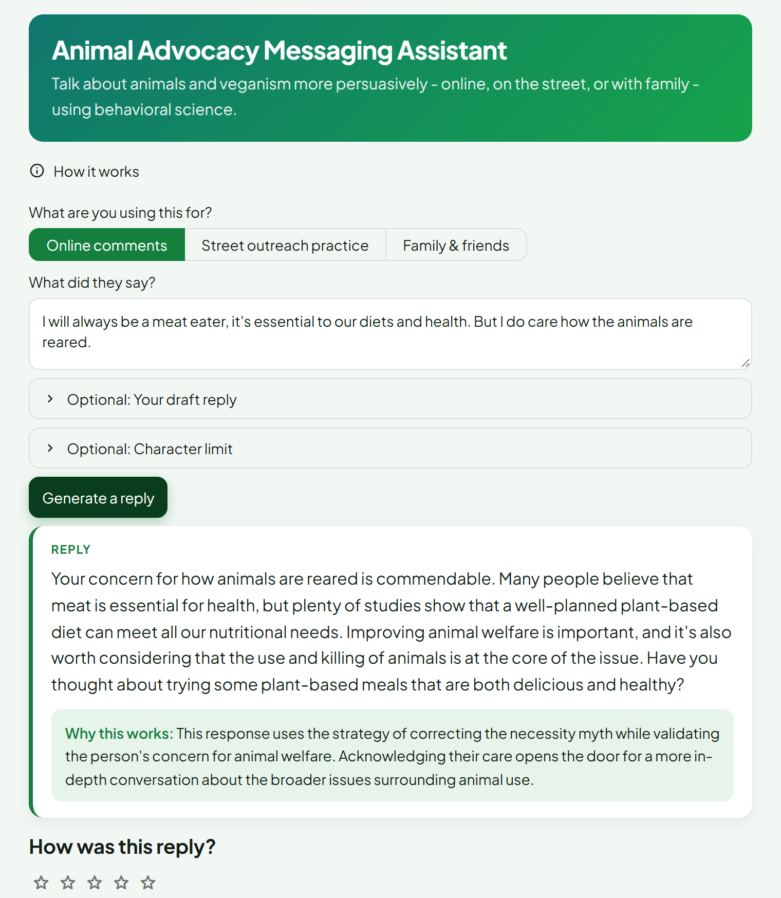

# AI Powered Animal Advocacy Messaging Assistant Based On Behavioral Science
*Draft persuasive social media replies that change minds, not start fights.*

This tool helps animal rights advocates craft more persuasive social media comments using OpenRouter-powered language models and behavioral science strategies. It supports animal advocates in responding more effectively in online discussions, especially when engaging with meat-eaters.

Too often, pro-vegan or animal rights comments come across as moralizing or confrontational, which can trigger defensiveness and shut down conversation, instead of shifting attitudes. This assistant draws from behavioral science, strategic communication, and AI tools to rewrite or generate replies that build rapport, reduce resistance, and inspire change.

The tool is intended for both formal advocates working with organizations and "home advocates" - individuals who discuss animal rights or veganism online in their free time and want to communicate more effectively, in ways that connect, not divide.

## Why This Matters

In the age of AI, industries that profit from animal exploitation are already using advanced tools to shape public opinion at scale. If advocates fail to adapt, they risk falling behind in the conversations that shape hearts and minds.

This tool helps animal advocates stay effective by combining the psychology of persuasion with AI’s ability to analyze, tailor, and scale messages - turning online exchanges into opportunities for genuine mindset shifts.

A major challenge in animal advocacy is that even the most well-intentioned messages often trigger defensiveness rather than reflection. Research shows that people are more open to plant-based change when conversations feel respectful, non-judgmental, and achievable - an idea that initially inspired this tool through the work of Tobias Leenaert. Meeting people where they are builds more openness than all-or-nothing demands, especially when discussions touch deeply held beliefs, traditions, and identities.

## What This Tool Does

- Takes user input - comments that need a reply to and/or a draft reply from the user
- Extracts tags from input and matches relevant advocacy strategies
- Generates persuasive responses
- Explains the behavioral science technique used and why it fits the situation
- Accepts feedback and allows regeneration based on feedback
- Logs sessions for feedback and improvement 

## Features

- **Smart Tag Extraction** - Detects the key themes, topics, and emotional tones in any comment to understand the conversation’s core.

- **Strategy Matching with RAG** - Uses Retrieval-Augmented Generation to instantly connect your conversation context with a curated library of behavioral science–backed advocacy strategies.

- **Multi-Step Prompt Chaining** - Breaks the task into expert stages: tag extraction → strategy selection → persuasive reply → feedback-driven regeneration.

- **AI-Optimized Persuasion** - Crafts replies using proven psychological principles to avoid defensiveness, build rapport, and encourage openness to animal-friendly choices.

- **Educational Explanations** - Every reply comes with an explanation naming the specific behavioral science technique used and why it fits the situation, so advocates learn as they go, not just copy-paste a message.

- **Three Modes** - Online comments (the default), street outreach practice, and family & friends. Street outreach mode writes replies meant to be said out loud to a passer-by and adds a delivery tip, which makes it useful for activists rehearsing common objections before going out. Family & friends mode puts the long-term relationship ahead of winning one argument.

- **Engagement Assessment** - Flags comments where a full persuasive reply probably isn't worth it (bad-faith trolling, an explicit refusal to discuss, extreme entrenchment) and switches to a short reply that states values calmly and corrects any factual errors, without trying to persuade.

- **Natural-Sounding Replies** - The generation prompt steers away from the patterns that make text read as AI-written (em dashes, "it's not just X, it's Y", forced lists of three, uniform sentence rhythm), so replies sound like a person typed them.

- **Feedback-Driven Regeneration** - Takes your rating and written feedback to produce a sharper, more targeted reply that better fits your advocacy style.

- **Background Quality Scoring** - Every generated reply is scored by a separate, stronger judge model on how human it sounds, whether it addresses the actual point, specificity, persuasiveness, and tone. Scores are logged for later analysis, never shown in the UI.

- **Cloud-Based Session Logging** - Saves every session securely to Firebase Firestore for analysis, refinement, and future improvements.

- **Clarification Safeguards** - Pauses generation when input is too vague or off-topic, ensuring only relevant, high-quality outputs.

- **Prompt Injection Protection** - Built-in defenses to detect and block attempts to bypass or override the assistant’s intended purpose.

The strategy library currently holds 41 techniques drawn from advocacy research (Faunalytics, CEVA), social and moral psychology, and Ed Winters' work on responding to common objections. The full list of sources is in [References](#references) below, and each strategy in `strategies.json` links to its own source.

## Demo

[Try the App on Streamlit](https://behavioral-advocate-tool.streamlit.app/)

## Usage/Examples

1. Pick a mode (online comments, street outreach practice, or family & friends), then enter what the other person said, plus any context that helps.
2. Optionally, write your own draft reply.
3. The assistant will:
   - Generate a persuasive response using behavioral strategies.
   - Explain which technique it used and why it fits the situation.
4. You can rate the reply, you can also provide feedback to regenerate an improved reply.
5. The assistant will provide a further improved reply.

## Built With

- Python
- Streamlit
- OpenRouter (model-agnostic LLM access)
- Firebase Firestore

## Testing Methodology
**White-Box Testing**

The internal prompt chain was tested step-by-step to ensure:

- Accurate tag extraction
- Proper strategy injection
- Model adherence to prompt logic
- Correct handling of clarification cases (e.g., ambiguous input halts the chain)
- Proper formatting of JSON outputs across each prompt stage

**Black-Box Testing**

Realistic and adversarial inputs were tested to verify:

- Prompt injection resistance (e.g. “ignore instructions”, “act as...”)
- Clarification triggers for vague/conflicting comments
- Input/output formatting integrity
- No leakage of system prompt or strategy list in final responses

**Cross-Model Evaluation**

Since the assistant runs on OpenRouter rather than a single fixed provider, the `eval/` directory
holds a small, repeatable evaluation harness: a fixed set of representative and adversarial inputs
(friendly, hostile, vague, prompt-injection attempts, and more) run through the real prompt chain
against several candidate models at once. Each output is scored by a separate judge model against a
written rubric covering persuasiveness, tone, JSON format compliance, correct clarification
triggering, and injection resistance, producing a side-by-side comparison table. This is what's used
to decide which model the live app runs on, rather than relying on a handful of manual tries.

## Abuse & Jailbreaking Policy

This app is designed for ethical, constructive use in animal advocacy.
It includes basic protections against prompt injection and misuse.

Attempts to:

- Override system behavior (e.g., "Ignore all previous instructions")
- Extract internal logic or strategy mappings
- Generate harmful, deceptive, or off-topic content

…will be deflected, logged, and flagged. Users may be restricted from access if abuse is detected. Future deployments may include stricter moderation and authentication.

## References

The strategies the assistant draws on come from the sources below.

**Advocacy research**
- Center for Effective Vegan Advocacy (CEVA) - [resources](https://veganadvocacy.org/resources/) (validating before redirecting, sharing a personal journey, asking thoughtful questions, calm modeling)
- Faunalytics - [How to become a more effective vegan advocate](https://faunalytics.org/how-to-become-a-more-effective-vegan-advocate/)
- Faunalytics - [Tactics in practice: the science of social media advocacy](https://faunalytics.org/tactics-in-practice-the-science-of-social-media-advocacy/)
- Faunalytics - [Effective wild animal advocacy should consider diverse audiences](https://faunalytics.org/effective-wild-animal-advocacy-should-consider-diverse-audiences/)
- Faunalytics - [Vegetarians choose change over justification for dairy](https://faunalytics.org/vegetarians-choose-change-over-justification-for-dairy/)
- Faunalytics - [Empathy for animals does not have to be zero-sum](https://faunalytics.org/empathy-for-animals-does-not-have-to-be-zero-sum/)
- Tobias Leenaert, via Faunalytics - [Time for pragmatic vegan advocacy](https://faunalytics.org/time-pragmatic-vegan-advocacy/)
- Emily Moran Barwick (Bite-Size Vegan) - [Should vegans empathize with meat-eaters?](https://bitesizevegan.org/should-vegans-empathize-with-meat-eaters/)
- Ed Winters (Earthling Ed) - [responses to common objections to veganism](https://www.all-creatures.org/articles2/act-earthling-ed.pdf) (used for 17 strategies, from the Socratic reframe to "one person can't make a difference")

**Psychology research**
- Piazza, Ruby, Loughnan et al. (2015) - the "4Ns" of meat justification (natural, normal, necessary, nice), [summarized by Faunalytics](https://faunalytics.org/rationalizing-meat-consumption-the-4ns/)
- Rosenfeld, Rothgerber & Tomiyama (2020) - the psychology of flexitarianism, [summarized by Faunalytics](https://faunalytics.org/the-psychology-of-flexitarianism/)
- Feinberg & Willer (2013) - [The moral roots of environmental attitudes](https://ccare.stanford.edu/wp-content/uploads/2015/06/Feinberg-and-Willer-2013-The-moral-roots-of-environmental-attitudes.pdf) (moral reframing)
- Dhont, Hodson & Leite - the Social Dominance Human-Animal Relations Model (SD-HARM)
- Paul Slovic - the [identifiable victim effect](https://en.wikipedia.org/wiki/Identifiable_victim_effect) and psychic numbing
- Batson (perspective-taking), with Sassenrath, Vorauer & Hodges on [when perspective-taking backfires](https://www.sciencedirect.com/science/article/abs/pii/S2352250X2100169X)
- The [foot-in-the-door technique](https://en.wikipedia.org/wiki/Foot-in-the-door_technique)
- Greater Good Science Center - [How to depolarize your social media feeds](https://greatergood.berkeley.edu/article/item/how_to_depolarize_your_social_media_feeds)
- Animal Ethics - [The objection that eating animals is natural](https://www.animal-ethics.org/the-objection-that-eating-animals-is-natural/)

Two strategies are my own formulations: one for responding to ex-vegans (affirm the need behind leaving, then bridge to support) and one for validating real access barriers while reframing imperfect effort as progress.

## License

All rights reserved. 
This project is provided for educational and showcase purposes only.  
You may not reuse, modify, or distribute any part of this code or content without explicit permission.

## Authors

Joanna A. Mazurek
- [@joannofjoy](https://github.com/joannofjoy)

## Acknowledgements

Project prepared under the mentorship of [**Ghaith Ahmad** (@RainZoneO2)](https://github.com/RainZoneO2) for the **Futurekind AI Fellowship (Electric Sheep)**.

Further developed with mentorship from **James Morgan**, as part of the **Sentient Futures** project incubator.

